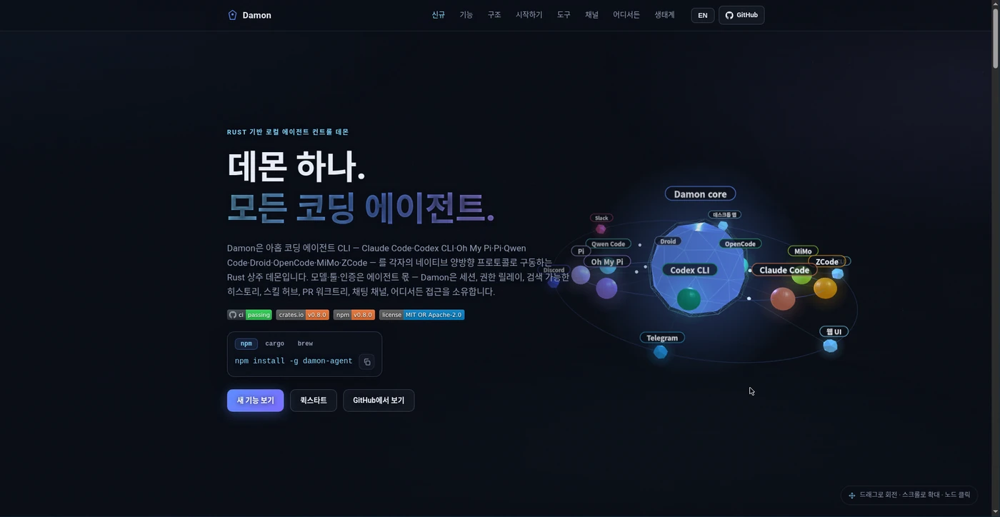
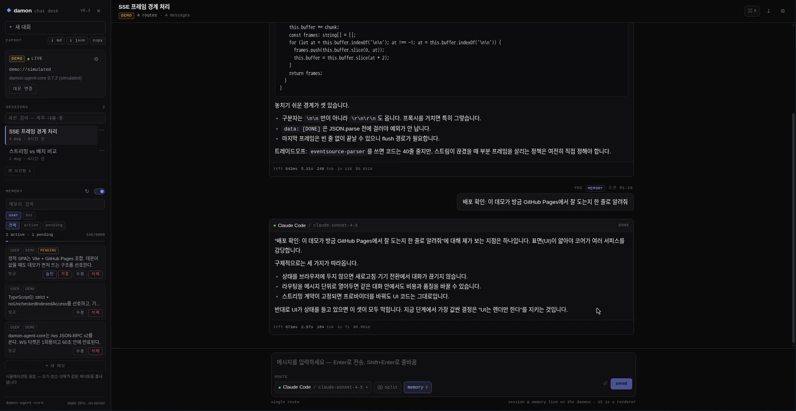
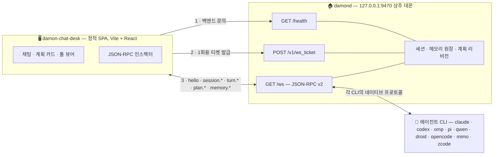
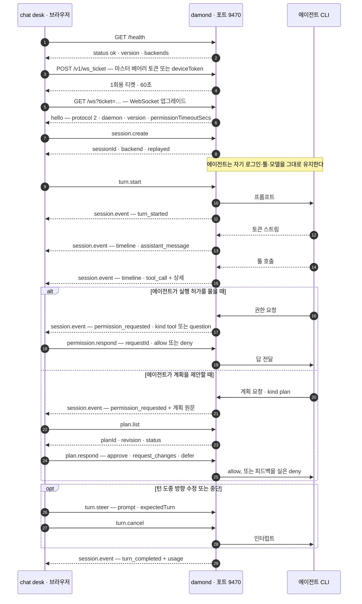

# Damon

[English](README.md) | **한국어**

[](https://github.com/developjik/damon-agent-core/actions/workflows/ci.yml)
[](https://crates.io/crates/damon-core)
[](https://www.npmjs.com/package/damon-agent)
[](LICENSE-MIT)

**데몬 하나. 모든 코딩 에이전트.**

<p align="center">
  <a href="https://developjik.github.io/damon-agent-core/"></a>
</p>

<p align="center"><a href="https://developjik.github.io/damon-agent-core/"><b>▶ 라이브 사이트 — developjik.github.io/damon-agent-core</b></a></p>

Damon은 Rust로 만든 로컬 에이전트 컨트롤 데몬이다. 아홉 코딩 에이전트 CLI — Claude Code, Codex CLI, Oh My Pi, Pi, Qwen Code, Droid, OpenCode, MiMo, ZCode — 를 각자의 네이티브 양방향 프로토콜로 구동한다. 모델·툴·인증·컨텍스트 관리는 전부 에이전트 몫이고, Damon은 세션, 권한 릴레이, 검색 가능한 히스토리, 채팅 채널, 원격 접근을 소유한다. CLI, 텔레그램 봇, 데스크톱 앱, 웹 UI는 전부 같은 상주 데몬에 붙는 얇은 클라이언트다.

이름은 *daemon*의 말장난이자, 말 그대로 실제 아키텍처다.

## 왜 Damon인가

이미 에이전트 CLI를 구독으로 쓰고 있다면 **설정이 하나도 없다**. Damon은 설치된 CLI를 감지하고, 로그인 상태와 툴을 그대로 물려받는다. 토큰 로테이션도, 프로바이더 번역도, API 키도 더 이상 Damon 몫이 아니다.

- **설정 없는 백엔드** — 카탈로그 CLI 바이너리가 PATH에 있으면 자동 등록: `claude`(stream-json), `codex`(app-server), `omp`(RPC 모드), `pi`(RPC 모드, omp와 같은 프로토콜 가족), `qwen`(stream-json, Claude형 컨트롤 플레인), `droid`(JSON-RPC, Factory), `opencode`·`mimo`(HTTP+SSE, `serve` 입양 또는 스폰), `zcode`(Z.ai app-server). 카탈로그에 오르는 백엔드는 전부 네이티브 양방향 프로토콜 — 토큰 스트리밍, 턴 도중 권한 요청, 인터럽트 — 을 말하므로, Damon이 온전히 구동할 수 있는 CLI만 등재된다. `[backends.X]`는 구동 라인만 오버라이드하며 프로토콜을 추가하지는 않는다.
- **권한은 채널 그대로** — 에이전트의 권한 요청을 웹 UI, CLI, 텔레그램/디스코드/슬랙 채팅의 `allow`/`deny` 답장으로 릴레이한다.
- **검색 가능한 히스토리** — 모든 대화를 SQLite + FTS5에 기록. `damon search "error timeout"`으로 전체 이력 전문 검색.
- **스킬 허브 + 프롬프트 라이브러리** — 에이전트 스킬 패키지를 한 번 설치하면(`damon skills install anthropics/skills document-skills/pdf`) 허브가 설치된 각 CLI의 네이티브 스킬 디렉터리로 싱크한다(심볼릭링크, 실패 시 복사; 스킬 로딩은 여전히 CLI 자신이). GitHub 리포 디스커버리, skills.sh 검색, 재사용 프롬프트 관리 — 웹 UI의 `/`, `@`, `!` 피커가 전부 보게 된다. `[skills] enabled = false`로 끌 수 있다.
- **워크트리 워크스페이스 — PR 하나, 에이전트 하나** — `damon worktree create . --pr 123`이 `refs/pull/123/head`를 격리된 `git worktree`로 받아 프로젝트로 등록하고, `session.create {projectId}`로 에이전트를 깨끗한 체크아웃에 배치한다. 스테이지 진행 실시간 표시(`validate → fetch → add → register`), fetch 도중 취소 가능, `gh` 기반 PR 미리보기(gh가 없어도 번호·리포는 확인), 세션이 묶여 있으면 제거 거부.
- **채팅 채널 내장** — Telegram, Discord, Slack 어댑터가 별도 바이너리로 나간다. 채널별 세션 자동 매핑, 스트리밍 응답.
- **시크릿은 Damon에 없다** — 에이전트가 자기 인증을 관리한다. Damon config는 포트와 토큰 정도뿐.
- **어디서든 접근** — 자체 인증서로 `wss` 서빙, 또는 공개 호스트에 `damon-relay`를 띄우면 데몬이 아웃바운드로 연결한다(인바운드 포트 불필요). 터널은 X25519 + AES-256-GCM으로 E2E 암호화.
- **상주하도록 설계** — Rust 데몬 본체는 가볍다(에이전트 프로세스는 에이전트 몫).

## 설치

```sh
npm install -g damon-agent        # npm (프리빌트 바이너리)
cargo install damon-core          # crates.io
brew install developjik/tap/damon # Homebrew tap
pip install -e python             # Python 클라이언트 (소스 설치)
```

또는 [GitHub Releases](https://github.com/developjik/damon-agent-core/releases)에서 플랫폼별 tarball — macOS(arm64/x86_64), Linux, Windows.

OS 서비스로 등록해 항상 띄워두기:

```sh
damond service install   # launchd / systemd user / Task Scheduler
damond service print     # 설치 전 정의 미리보기
```

## Quickstart

```sh
damond                          # 첫 실행 시 스타터 config 생성
damond doctor                   # 어떤 백엔드가 설치됐는지 확인
```

에이전트 CLI가 설치·로그인돼 있으면 그게 전부다:

```sh
curl localhost:9470/health
# {"backends":["claude","omp"],"status":"ok",...}
```

번들 웹 UI로 대화: `http://127.0.0.1:9470/ui` — 세션, 스트리밍, 권한 프롬프트까지, 설치 불필요. 스트리밍 답변은 도착 케이던스에 맞춰 흘러나오고(배치 덤프 없음) 그래펨 경계가 안전하며, 코드펜스는 문법 하이라이트로 렌더됩니다. `?revealDemo=1`을 붙이면 백엔드 없이 데모를 볼 수 있습니다.

<p align="center">
  
</p>

<p align="center"><sub>같은 API 위의 채팅 표면 — <a href="https://github.com/developjik/damon-chat-desk">chat desk</a>. 세션·메모리·툴 권한은 데몬의 것이고, UI는 그것을 그릴 뿐입니다.</sub></p>

## 구조

```
[CLI] [Telegram] [Discord] [Slack] [web] [desktop app] [직접 만든 코드]
                              |
        단일 API: JSON-RPC over WebSocket (`/ws`, 프로토콜 v2)
                              |
                    Damon core (상주 데몬 · Rust)
                     ├─ 백엔드 레지스트리 — 설치된 CLI 탐지·구동·재시작
                     ├─ 세션 매니저 — 생명주기, 권한 릴레이, 취소
                     ├─ 세션 저장소 — SQLite + FTS5 전문 검색
                     └─ 채널 브리지 / E2E 릴레이
                              |
            claude · codex · omp · pi · qwen · droid · opencode · mimo · zcode
             (네이티브 CLI subprocess — 모델, 툴, 구독 인증,
                        컨텍스트는 전부 에이전트 소유)
```

### 구조 — 데몬 하나, 와이어 하나, 모든 서피스

같은 그림에 브라우저 표면을 이름 붙인 것이다. [`damon-chat-desk`](https://github.com/developjik/damon-chat-desk)는 자기 서버가 없는 정적 SPA다 — 세션, 메시지, 메모리, 계획 리비전은 전부 CLI와 채팅 봇이 이미 쓰는 그 와이어로 데몬에서 읽어 온다.



이 와이어에서 중요한 세 가지:

- **`/health`가 URL 너머의 대상을 판별한다.** `backends[]`가 실려 오면 데몬이고, OpenAI 호환 서버는 대신 `/v1/models`에 답하며 `/health`는 보통 404다. 둘 다 답하지 않는 URL은 데모로 슬쩍 바꾸지 않고 "연결 불가"로 보고된다. 비루프백 바인드는 `{"status":"ok"}`만 답한다 — 백엔드 목록은 로컬에만 남는다.
- **`/v1/ws_ticket` → `/ws` 순서.** 브라우저는 WebSocket 업그레이드에 `Authorization` 헤더를 붙일 수 없다. 그래서 `POST /v1/ws_ticket`이 마스터 베어러 토큰(또는 승인된 기기의 `deviceToken`)을 60초짜리 1회용 티켓으로 바꿔 주고, 소켓은 `/ws?ticket=…`으로 열린다. 티켓은 성공 여부와 무관하게 첫 시도에서 소비되고, 쿼리 문자열의 원본 토큰은 로그에 남기 때문에 거부된다. `auth_token`이 설정돼 있지 않은 루프백 바인드는 열린 상태다.
- **소켓 하나가 모든 세션을 다중화한다.** 요청은 동시에 디스패치되므로 스트리밍 중인 `turn.start`가 `turn.steer`, `turn.cancel`, `permission.respond`를 막지 않는다.

### 와이어 — 핸드셰이크 · 턴 · 승인 · 인터럽트

브라우저 쪽에서 본 첫 턴 전체다. 화살표 위의 이름이 실제 JSON-RPC 메서드와 라우트이고, 봉투와 오류 코드는 [docs/protocol-v2.md](docs/protocol-v2.md)에 있다.



클라이언트가 기댈 수 있는 것:

- **붙는 순간 리플레이.** 세션에 처음 닿는 연결(`session.create`, `session.resume`, `turn.start`)은 놓친 것을 먼저 받는다 — `"replay": true`가 붙은 `session.event` 프레임으로, 저장된 행(최신이 마지막, 200개 상한) 다음에 진행 중인 턴의 저널이 온다. 결과의 `replayed`가 보낸 프레임 수다.
- **계획 결정은 CAS다.** `plan.respond`는 `expectedRevision`을 실어 보내므로 같은 리비전에 두 서피스가 답하면 정확히 하나만 이기고 진 쪽은 타입이 붙은 `-32009`를 받는다. 결정은 에이전트로 릴레이되기 전에 저장되므로, 중간에 끊긴 연결은 성공하지 않은 일을 성공으로 보고하지 않고 행을 다시 연다.
- **스티어는 백엔드 능력이다.** 턴 도중 방향 수정을 지원하지 않는 백엔드에서는 `turn.steer`가 `-32002`로 거절한다 — 턴을 실패시키지 말고 그 문장을 다음 프롬프트로 큐에 넣으면 된다.
- **`turn.cancel`은 이미 온 것을 지우지 않는다.** 부분 응답은 트랜스크립트에 그대로 남고 카드는 canceled로 닫혀, 다시 시도하거나 그 지점에서 분기할 수 있다.
- **분리된 턴은 소켓보다 오래 산다.** `turn.start {detach: true}`는 즉시 `{turnId, detached: true}`로 답하고 어떤 연결도 소유하지 않은 태스크에서 계속 돈다 — 잠긴 휴대폰의 경우다. 재접속하면 리플레이가 이어 받는다.

메서드 표와 이벤트 전문은 [docs/protocol-v2.md](docs/protocol-v2.md), Node/Python/Rust 복붙 클라이언트는 [docs/integration.ko.md](docs/integration.ko.md) 참조.

## chat desk — 라이브 데모와 로컬 연동

[`damon-chat-desk`](https://github.com/developjik/damon-chat-desk)는 이 프로토콜 그대로 위에 올린 기준 클라이언트다. 프로바이더 라우팅이 눈에 보이고, 턴 단위 분기, 메모리 원장 패널, 계획 승인 카드, 지나가는 프레임을 그대로 보여 주는 JSON-RPC 인스펙터가 있다.

**라이브 데모, 설치도 키도 없이:** <https://developjik.github.io/damon-chat-desk/> — 데모 모드(4개 프로바이더 시뮬레이션, 1클릭 시나리오, 실제 데몬과 같은 봉투를 흘리는 인스펙터)로 열린다. 공개된 HTTPS 페이지는 `http://127.0.0.1`에 닿을 수 없으므로(혼합 콘텐츠·사설망 차단) 그 자리에서는 데모가 도는 것이고, 아래 연동은 로컬 경로다.

### 내 데몬에 붙이기

```sh
# 1 — 이 저장소의 데몬 (기본 바인드 127.0.0.1:9470)
cargo run --bin damond
curl -s 127.0.0.1:9470/health
# {"status":"ok","version":"0.8.0","backends":["claude","omp"]}

# 2 — 데스크
git clone https://github.com/developjik/damon-chat-desk
cd damon-chat-desk
npm install
npm run dev            # http://127.0.0.1:5173/
```

그다음 데스크에서 **⚙ → Damon daemon → `/dm` 로컬 프록시 버튼**(`로컬 프록시 /dm`). 그게 전부다 — 데몬 URL은 이미 `http://127.0.0.1:9470`이 기본이고, `auth_token`을 설정하지 않은 루프백에서는 티켓 라우트가 열려 있어 마스터 토큰 칸은 비워 두면 된다.

### 왜 `/dm` 프록시인가

데몬은 자기 UI를 `/ui`로 직접 서빙하고 CORS 헤더를 보내지 않는다. 그래서 다른 오리진의 페이지는 `fetch`로 데몬을 부를 수 없다. `npm run dev`(포트 5173, `npm run preview`는 4173)는 데스크를 띄우면서 `/dm/*`을 `http://127.0.0.1:9470/*`로 프리픽스를 떼어 프록시한다 — `ws: true`라서 `/dm/ws` 업그레이드도 그대로 통한다. 오리진 하나, CORS 없음, 데몬 변경 없음.

| 데스크 동작 | 실제로 데몬에 닿는 것 |
| --- | --- |
| 연결 | `GET /dm/health` → `POST /dm/v1/ws_ticket` → `GET /dm/ws?ticket=…` |
| 전송 | `turn.start`, 이어서 `session.event` 델타 |
| 턴 중 방향 수정 | `turn.steer` |
| 중단 | `turn.cancel` |
| 계획 승인 | `plan.list` → `expectedRevision`을 실은 `plan.respond` |
| 툴 허용 | `permission.respond` |
| 턴 분기 | `session.fork` |
| 메모리 패널 | `memory.list` · `memory.write` · `memory.remove` · `memory.approve` · `memory.reject` |

### 다른 기기의 데몬에 붙이기

HTTPS 오리진의 페이지는 데몬까지 같은 오리진 경로가 필요하다. 같은 `/dm` 리라이트를 적용하는 리버스 프록시를 앞에 두면 그것으로 끝난다. 마스터 토큰을 넘기고 싶지 않은 브라우저는 대신 페어링한다 — `device.pairing_key`로 1회용 키를 꺼내 `POST /v1/pair`로 쓰고, 신뢰하는 서피스에서 `device.approve`로 승인하면, 데스크는 그 기기의 `deviceToken`을 보관한다. 이 토큰은 티켓을 발급하며 기기 단위로 폐기된다.

아직 에이전트 CLI가 없다면 데스크의 `python3 tools/mock-daemon.py`를 쓰면 된다 — `:9470`에 같은 표면(health, 티켓, `/ws`, 스트리밍 `turn.start`, 계획 승인, `memory.*`)을 세워 에이전트 없이 연동을 확인할 수 있다.

## 설정

플랫폼 config 디렉터리의 TOML 파일 하나. 변경 시 핫리로드:

```toml
# 아무 것도 없어도 동작한다. 아래는 전부 선택.

# bind = "127.0.0.1:9470"          # 기본값; 변경은 재시작 필요
# auth_token = "env:DAMON_TOKEN"   # 비루프백 바인드에 필수
# default_backend = "claude"       # session.create가 backend를 생략할 때

# 백엔드 구동 오버라이드 (예: 로컬 어댑터 빌드 사용):
# [backends.claude]
# command = "/opt/claude"
# [backends.claude.env]
# ANTHROPIC_MODEL = "claude-sonnet-4-5"

# MCP 서버는 데몬 설정이 아니라 세션 단위다: session.create의
# `mcpServers`로 전달 — 에이전트가 직접 구동·승인한다
# (현재 claude만 전달하며, 다른 백엔드는 이 파라미터를 무시한다).
```

전체 레퍼런스: [config.example.toml](config.example.toml).

## 채팅 채널

```sh
damon-telegram --bot-token <token>
damon-discord  --bot-token <token>
damon-slack    --app-token xapp-… --bot-token xoxb-…
```

채널의 각 채팅이 고유한 에이전트 세션에 매핑되고, 응답은 스트리밍되며, tool 권한 요청은 Telegram/Discord/Slack 모두 네이티브 버튼으로 도착한다(Slack은 Socket Mode로 버튼 눌림이 전달된다 — 앱 설정에서 Interactivity를 Socket Mode로 활성화할 것). `allow`/`deny`/`always` 답장도 어디서든 동작하고, 채널로 보낸 파일은 프롬프트 첨부로 함께 전달된다(Discord CDN URL은 Slack의 `url_private`처럼 프롬프트 시점에 내려받는다). `!cwd <dir>`과 `!agent <backend>`로 대화의 프로젝트·백엔드를 정하고, `!new`/`!fork`/`!delete`/`!cancel`/`!usage`도 함께 쓴다. 표면을 넘나드는 세션 픽업: `!sessions`로 모든 화면의 최근 세션을 보고, `!resume <id|제목>`으로 이 채팅에서 이어한다(자동 감시). `!watch`/`!unwatch <id|제목>`는 세션을 따라가 턴 완료·권한 요청을 이 채팅으로 알려준다 — 턴이 웹 UI나 CLI에서 돌아도 `allow`/`deny` 답장으로 바로 승인할 수 있다. 새 채널은 `damon_core::channel::ChannelApi`(`ready`/`recv`/`send`/`send_permission`/`send_media`)를 구현해 `Bridge`에 넘기면 된다 — 세션 매핑, 이벤트 demux, 권한 흐름은 이미 구현돼 있다.

## 미션 (스테이지)

`damon mission create <flow.json> && damon mission start <flow-id>`로 단계형 에이전트 워크플로를 실행한다: 조건 라우팅 엣지 위의 `input → agent → human → output` 노드(`key=value` 분기는 각 단계의 `key=value` 출력 라인을 읽고, 조건 없는 엣지는 아무것도 안 맞았을 때만 발화). 에이전트 노드는 노드별 세션에서 실제 damon 턴으로 실행 — 일반 전사본처럼 검색 가능 — 하한 병렬 제한과 단계별 재시도를 거쳐 실패는 정직하게 `failed`. 읽기 전용 단계는 `allowedTools`를 런치 라인에 싣고 강제할 수 없는 백엔드에서는 거부된다(claude는 가능; 절대 강등 없음). 휴먼 게이트는 실행을 `waiting_human`에 세운다: 웹 UI의 미션 드로어에서 답하거나 `damon mission respond`. 모든 전이는 팬아웃 전에 SQLite에 저장되므로 데몬 재시작 시 끝나지 않은 실행은 `interrupted`로 수렴 — 실행 중인 것처럼 가장하지 않는다. 스테이지 범위: `foreach` 없음, 채널 기반 승인 없음, 실행 중 미션 편집 없음.

## 원격 접근

- **Tailscale**(권장): `ws://<tailscale-ip>:9470/ws`로 attach — WireGuard E2E, 데몬 설정 변경 없음.
- **직접 TLS**: `tls_cert`/`tls_key` 설정 시 `wss` 서빙. 비루프백 바인드는 `auth_token` 없이 기동을 거부한다.
- **자체 릴레이**: 공개 호스트에 `damon-relay`를 띄우고 데몬 config에 `[relay]` 추가 — 데몬이 아웃바운드로 연결하므로 인바운드 포트 불필요. X25519 키 교환 + `sha256(auth_token ‖ pubkey)` 증명 → AES-256-GCM; 릴레이는 평문을 볼 수 없다.
- **어디서든 웹 UI**: 릴레이 자체가 번들 UI를 루트에서 서빙한다 — 폰이나 노트북 브라우저로 `http(s)://릴레이호스트/`를 열고 데몬 이름과 auth 토큰을 입력하면, 페이지가 같은 릴레이를 통해 E2E 핸드셰이크로 접속한다. VPN·포트포워딩·앱 설치가 필요 없고, 브라우저가 자체 암호화를 수행하므로 일반 `ws://` 호스팅에서도 동작한다.
- **디바이스별 페어링**: 모든 기기에 마스터 `auth_token`을 나눠주는 대신, 설정 서랍에서 일회용 페어링 키를 공개하고(`device.pairing_key`) 기기가 `POST /v1/pair`로 소비하게 한 뒤, 신뢰하는 표면에서 대기 요청을 승인한다. 기기는 자체 토큰(데몬에는 SHA-256 해시로만 저장, 기기별 폐기 가능)을 받아 WS 티켓을 발급한다; revoke하면 즉시 무효다. 직접 닿는 기기는 웹 UI의 "pair this device" 폼으로 페어링하고, 릴레이 모드 기기는 기존 마스터 토큰 로그인을 유지한다.

## 문서

- **[프로젝트 홈페이지](https://developjik.github.io/damon-agent-core/)** — Damon 한눈에 보기
- [damon-chat-desk](https://github.com/developjik/damon-chat-desk) — 이 API 위의 기준 웹 클라이언트 ([라이브 데모](https://developjik.github.io/damon-chat-desk/))
- [docs/features.ko.md](docs/features.ko.md) ([en](docs/features.md)) — 기능 안내서, 그림 포함 (비개발자용; [브라우저 버전](docs/features.ko.html))
- [docs/protocol-v2.md](docs/protocol-v2.md) — 와이어 프로토콜 (메서드, 이벤트, 타입)
- [docs/install.ko.md](docs/install.ko.md) ([en](docs/install.md)) — 설치 경로, 서비스 등록
- [docs/integration.ko.md](docs/integration.ko.md) ([en](docs/integration.md)) — 에이전트 연결, 최소 클라이언트
- [docs/release.ko.md](docs/release.ko.md) ([en](docs/release.md)) — 릴리스 체크리스트
- [config.example.toml](config.example.toml) — 모든 옵션 주석 포함
- `import { DamonClient } from "damon-agent"` — npm 패키지에 포함된 무의존성 Node 클라이언트
- `pip install -e python` — asyncio Python 클라이언트, 소스에서 설치 ([python/](python))

## 기여

[CONTRIBUTING.md](CONTRIBUTING.md) 참조. CI는 macOS, Windows, Linux에서 `cargo test`를 돌린다.

## 라이선스

[MIT](LICENSE-MIT) 또는 [Apache-2.0](LICENSE-APACHE) 듀얼 라이선스 — 선택 가능.
