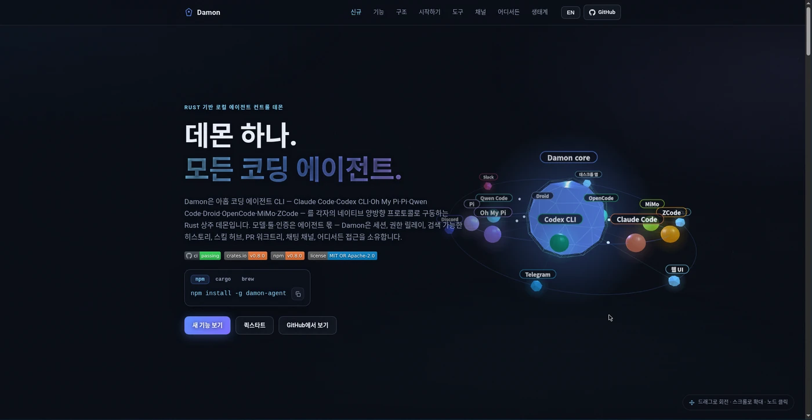
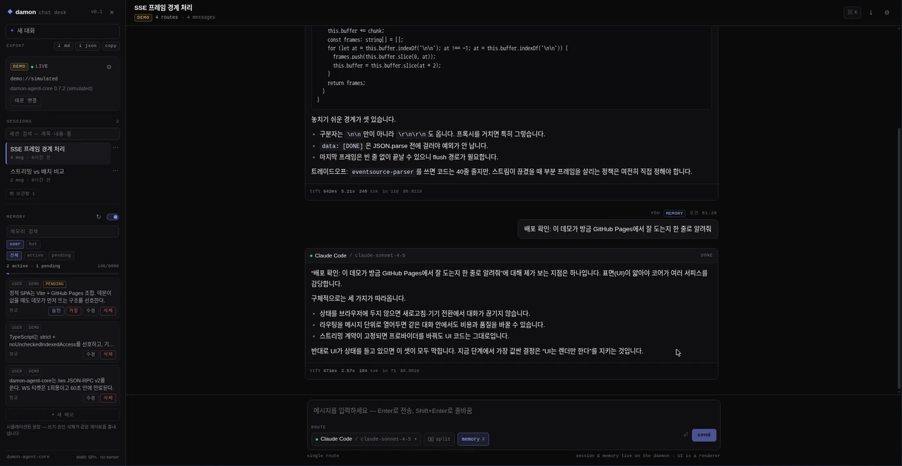
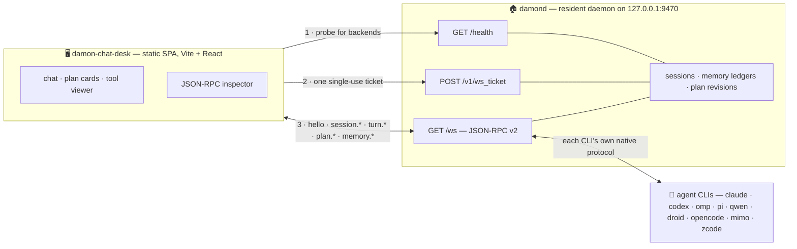
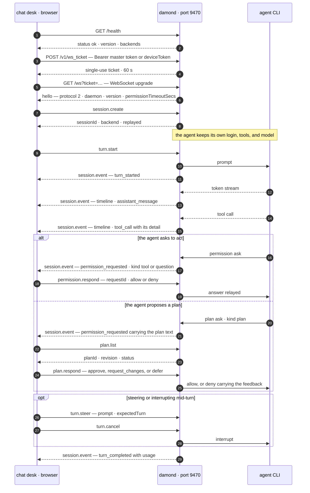

# Damon

**English** | [한국어](README.ko.md)

[](https://github.com/developjik/damon-agent-core/actions/workflows/ci.yml)
[](https://crates.io/crates/damon-core)
[](https://www.npmjs.com/package/damon-agent)
[](LICENSE-MIT)

**One daemon. Every coding agent.**

<p align="center">
  <a href="https://developjik.github.io/damon-agent-core/"></a>
</p>

<p align="center"><a href="https://developjik.github.io/damon-agent-core/"><b>▶ Live site — developjik.github.io/damon-agent-core</b></a></p>

Damon is a local agent-control daemon written in Rust. It drives nine coding-agent CLIs — Claude Code, Codex CLI, Oh My Pi, Pi, Qwen Code, Droid, OpenCode, MiMo, ZCode — over their native bidirectional protocols; the model, tools, credentials, and context management belong to the agents, while Damon owns sessions, permission relaying, searchable history, chat channels, and remote access. The CLI, Telegram bot, desktop app, and web UI are all thin clients on the same resident daemon.

The name is a pun on *daemon*, and literally the architecture.

## Why Damon

If you already subscribe to an agent CLI, **there is nothing to configure**. Damon detects the installed CLIs and inherits their logins and tools. Token rotation, provider translation, API keys — not Damon's problem anymore.

- **Zero-config backends** — a catalog CLI binary on PATH registers itself: `claude` (stream-json), `codex` (app-server), `omp` (RPC mode), `pi` (RPC mode, omp's protocol family), `qwen` (stream-json, Claude-shaped control plane), `droid` (JSON-RPC, Factory), `opencode`+`mimo` (HTTP+SSE, adopts or spawns `serve`), `zcode` (Z.ai app-server). Every listed backend speaks a native bidirectional protocol — token streaming, mid-turn permission asks, interrupt — so the catalog only admits CLIs Damon can drive fully. `[backends.X]` overrides launch lines; it does not add protocols.
- **Permissions flow to your surface** — the agent's permission ask is relayed to the web UI, CLI, or a Telegram/Discord/Slack `allow`/`deny` reply.
- **Searchable history** — every conversation lands in SQLite + FTS5. `damon search "error timeout"` full-text-searches all of it.
- **Skills hub + prompt library** — install agent-skill packages once (`damon skills install anthropics/skills document-skills/pdf`) and the hub syncs them into every installed CLI's own native skills directory (symlink, copy fallback; the CLIs keep loading skills themselves). Discover from GitHub repos, search skills.sh, manage reusable prompts; the web UI's `/`, `@`, and `!` pickers see everything. `[skills] enabled = false` turns it off.
- **Worktree workspaces — one PR, one agent** — `damon worktree create . --pr 123` fetches `refs/pull/123/head` into an isolated `git worktree`, registers it as a project, and `session.create {projectId}` lands the agent in the clean checkout. Live stage progress (`validate → fetch → add → register`), cancellable mid-fetch, `gh`-enriched PR previews that degrade gracefully when gh is absent, and removal that refuses while sessions are still bound.
- **Chat channels built in** — Telegram, Discord, and Slack adapters ship as separate binaries. Per-chat session mapping, streamed replies.
- **Damon holds no secrets** — agents manage their own auth. The Damon config is a port and maybe a token.
- **Reachable from anywhere** — serve `wss` with your own certs, or run `damon-relay` on a public host and the daemon dials out (no inbound port). The tunnel is X25519 + AES-256-GCM end-to-end encrypted.
- **Built to stay resident** — the Rust daemon itself stays lean (agent processes are the agents' business).
- **OS sandbox for the agent's own commands (Linux, first cut)** — `sandbox = "auto"` wraps each agent CLI child in bubblewrap: the workdir (and the CLI's own auth dir) writable, the host root read-only, credential stores (`~/.ssh`, `~/.aws`, `~/.gnupg`, …) masked, `SSH_AUTH_SOCK` scrubbed. Naming a driver the host cannot honor fails the session at start instead of silently running unconfined; `damond doctor` reports what each backend would get. Seatbelt (macOS) and Docker drivers follow.

## Install

```sh
npm install -g damon-agent        # npm (prebuilt binaries)
cargo install damon-core          # crates.io
brew install developjik/tap/damon # Homebrew tap
pip install -e python             # Python client (from source)
```

Or platform tarballs from [GitHub Releases](https://github.com/developjik/damon-agent-core/releases) — macOS (arm64/x86_64), Linux, Windows.

Keep it running as an OS service:

```sh
damond service install   # launchd / systemd user / Task Scheduler
damond service print     # preview the definition before installing
```

## Quickstart

```sh
damond                          # writes a starter config on first run
damond doctor                   # which backends are installed?
```

With an agent CLI installed and logged in, that's the whole setup:

```sh
curl localhost:9470/health
# {"backends":["claude","omp"],"status":"ok",...}
```

Chat in the bundled web UI: `http://127.0.0.1:9470/ui` — sessions, streaming, permission prompts, no install. Streaming replies are paced over the arrival cadence (no batch dumps) with grapheme-safe rendering and syntax-highlighted code; `?revealDemo=1` on the URL demos it without a backend.

<p align="center">
  
</p>

<p align="center"><sub>A chat surface on the same API — <a href="https://github.com/developjik/damon-chat-desk">chat desk</a>. The session, memory, and tool permissions are the daemon's; the UI only renders them.</sub></p>

## Architecture

```
[CLI] [Telegram] [Discord] [Slack] [web] [desktop app] [your code]
                              |
        one API: JSON-RPC over WebSocket (`/ws`, protocol v2)
                              |
                    Damon core (resident daemon · Rust)
                     ├─ backend registry — detect, spawn, restart installed CLIs
                     ├─ session manager — lifecycle, permission relay, cancel
                     ├─ session store — SQLite + FTS5 full-text search
                     └─ channel bridges / E2E relay
                              |
            claude · codex · omp · pi · qwen · droid · opencode · mimo · zcode
             (native CLI subprocesses — model, tools, subscription auth,
                        and context all agent-owned)
```

### Topology — one daemon, one wire, every surface

The same shape with the browser surface named. [`damon-chat-desk`](https://github.com/developjik/damon-chat-desk) is a static SPA with no server of its own: sessions, messages, memory, and plan revisions are all read from the daemon over the wire the CLI and the chat bots already use.



Three details on that wire are load-bearing:

- **`/health` decides what is behind a URL.** An answer carrying `backends[]` is a daemon; an OpenAI-compatible server answers `/v1/models` instead and usually 404s `/health`; a URL that answers neither is reported unreachable rather than silently switched to a demo. A non-loopback bind answers `{"status":"ok"}` only — the roster stays local.
- **`/v1/ws_ticket`, then `/ws`.** A browser cannot put an `Authorization` header on a WebSocket upgrade, so `POST /v1/ws_ticket` trades a master bearer token — or an approved device's own `deviceToken` — for a single-use ticket good for 60 seconds, and the socket opens as `/ws?ticket=…`. The ticket is consumed on the first attempt whether or not it succeeds, and a raw token in the query string is refused because it leaks into logs. Loopback with no `auth_token` configured stays open.
- **One socket multiplexes every session.** Requests dispatch concurrently, so a streaming `turn.start` never blocks `turn.steer`, `turn.cancel`, or `permission.respond`.

### Wire — handshake, turn, approval, interrupt

A full first turn from the browser's side. The names on the arrows are the exact JSON-RPC methods and routes; envelopes and error codes are in [docs/protocol-v2.md](docs/protocol-v2.md).



What a client can rely on:

- **Replay on attach.** The connection that first touches a session (`session.create`, `session.resume`, `turn.start`) receives what it missed first, as `session.event` frames tagged `"replay": true` — persisted rows, newest last and capped at 200, then the in-flight journal. `replayed` in the result says how many frames arrived.
- **Plan decisions are compare-and-set.** `plan.respond` carries `expectedRevision`, so two surfaces answering the same revision resolve to exactly one win and a typed `-32009` for the loser; the decision is persisted before it is relayed to the agent, so a lost pipe reopens the row instead of reporting a success that did not happen.
- **Steering is a backend capability.** `turn.steer` refuses with `-32002` on a backend that cannot steer mid-turn — queue that text as the next prompt instead of failing the turn.
- **`turn.cancel` keeps what already arrived.** The partial answer stays in the transcript and the card closes as canceled, ready to retry or branch from.
- **Detached turns outlive the socket.** `turn.start {detach: true}` answers `{turnId, detached: true}` immediately and runs on a task no connection owns — the locked-phone case — while replay picks it up on reconnect.

See [docs/protocol-v2.md](docs/protocol-v2.md) for the full method table and events, and [docs/integration.md](docs/integration.md) for copy-paste Node/Python/Rust clients.

## Chat desk — live demo and local wiring

[`damon-chat-desk`](https://github.com/developjik/damon-chat-desk) is the reference client: a thin chat desk on exactly the protocol above — provider routing made visible, per-turn forking, a memory ledger panel, plan approval cards, and a JSON-RPC inspector that shows the frames as they move.

**Live demo, no install and no keys:** <https://developjik.github.io/damon-chat-desk/> — it opens in demo mode (four simulated providers, one-click scenarios, the inspector streaming the same envelopes a real daemon sends). A published HTTPS page cannot reach `http://127.0.0.1` (mixed content and private-network blocking), which is what the demo is for; the wiring below is the local path.

### Run it against your own daemon

```sh
# 1 — the daemon, from this repository (binds 127.0.0.1:9470 by default)
cargo run --bin damond
curl -s 127.0.0.1:9470/health
# {"status":"ok","version":"0.8.0","backends":["claude","omp"]}

# 2 — the desk
git clone https://github.com/developjik/damon-chat-desk
cd damon-chat-desk
npm install
npm run dev            # http://127.0.0.1:5173/
```

Then in the desk: **⚙ → Damon daemon → the `/dm` local proxy button** (`로컬 프록시 /dm`). Nothing else — the daemon URL already defaults to `http://127.0.0.1:9470`, and on loopback with no `auth_token` set the ticket route is open, so the master-token field stays empty.

### Why the `/dm` proxy

The daemon serves its own UI at `/ui` and sends no CORS headers, so a page on another origin cannot `fetch` it. `npm run dev` (port 5173; `npm run preview` uses 4173) therefore serves the desk and proxies `/dm/*` to `http://127.0.0.1:9470/*` with the prefix stripped — `ws: true`, so `/dm/ws` upgrades too. One origin, no CORS, no daemon change.

| Desk action | What actually reaches the daemon |
| --- | --- |
| connect | `GET /dm/health` → `POST /dm/v1/ws_ticket` → `GET /dm/ws?ticket=…` |
| send | `turn.start`, then `session.event` deltas |
| steer mid-turn | `turn.steer` |
| stop | `turn.cancel` |
| approve a plan | `plan.list` → `plan.respond` with `expectedRevision` |
| allow a tool | `permission.respond` |
| branch a turn | `session.fork` |
| memory panel | `memory.list` · `memory.write` · `memory.remove` · `memory.approve` · `memory.reject` |

### A daemon on another machine

An HTTPS-origin page needs a same-origin path to the daemon: a reverse proxy applying the same `/dm` rewrite is the whole rule. For a browser you would rather not hand the master token to, pair it instead — reveal a one-time key with `device.pairing_key`, spend it at `POST /v1/pair`, approve the pending row with `device.approve` from a trusted surface, and the desk keeps that device's own `deviceToken`, which mints tickets and is revocable per device.

No agent CLI installed yet? The desk ships `python3 tools/mock-daemon.py` — the same surface on `:9470` (health, ticket, `/ws`, a streaming `turn.start`, plan approval, `memory.*`) so the wiring can be exercised without an agent.

## Configuration

One TOML file in the platform config dir; hot-reloaded:

```toml
# Works with nothing set. Everything below is optional.

# bind = "127.0.0.1:9470"          # default; changing requires restart
# auth_token = "env:DAMON_TOKEN"   # required for non-loopback binds
# default_backend = "claude"       # when session.create omits `backend`

# Backend launch overrides (e.g. a local adapter build):
# [backends.claude]
# command = "/opt/claude"
# [backends.claude.env]
# ANTHROPIC_MODEL = "claude-sonnet-4-5"

# MCP servers are per-session, not daemon config: pass `mcpServers` in
# session.create — the agent spawns and permissions them itself
# (claude forwards them today; other backends ignore the param).
```

Full reference: [config.example.toml](config.example.toml).

## Chat channels

```sh
damon-telegram --bot-token <token>
damon-discord  --bot-token <token>
damon-slack    --app-token xapp-… --bot-token xoxb-…
```

Each chat maps to its own agent session, replies stream as rendered markdown, and a prompt arriving mid-turn is queued (bounded) instead of rejected. Tool-permission requests arrive as native buttons on Telegram, Discord, and Slack (Socket Mode delivers the presses — enable Interactivity with Socket Mode in the app config); a plain `allow`/`deny`/`always` reply works everywhere, and files sent to any channel ride along as prompt attachments (Discord CDN URLs are fetched at prompt time like Slack's). `!cwd <dir>` and `!agent <backend>` steer a conversation's project and backend, alongside `!new`/`!fork`/`!delete`/`!cancel`/`!usage`. Cross-surface pickup: `!sessions` lists recent sessions from every surface, `!resume <id|title>` continues one in this chat (auto-watched), and `!watch`/`!unwatch <id|title>` follow a session so completions and permission asks ping the chat — and `allow`/`deny` answers work there too — even when the turn runs on the web UI or CLI. A new channel implements `damon_core::channel::ChannelApi` (`ready`/`recv`/`send`/`send_permission`/`send_media`) and hands it to `Bridge` — session mapping, event demux, and the permission flow are already there.

## Missions (staged)

`damon mission create <flow.json> && damon mission start <flow-id>` runs a staged agent workflow: `input → agent → human → output` nodes over condition-routed edges (`key=value` branches read each step's `key=value` output lines; a condition-less edge fires only when nothing else matched). Agent nodes run as real damon turns on per-node sessions — searchable like any transcript — with bounded parallelism and per-step retries before an honest `failed`. Read-only stages carry `allowedTools` onto the launch line and are REFUSED on backends that cannot enforce it (claude yes; never downgraded). Human gates park the run at `waiting_human`: answer in the web UI's Missions drawer (approve / feedback / exclude) or `damon mission respond`. Every transition persists to SQLite before it fans out, so a daemon restart converges unfinished runs to `interrupted` — nothing is faked as still-running. Staged scope: no `foreach`, no channel-based approval, no editing a live mission.

## Remote access

- **Tailscale** (recommended): attach at `ws://<tailscale-ip>:9470/ws` — WireGuard E2E, no daemon changes.
- **Direct TLS**: set `tls_cert`/`tls_key` to serve `wss`. Non-loopback binds refuse to start without `auth_token`.
- **Self-hosted relay**: run `damon-relay` on a public host and add `[relay]` — the daemon dials out, so no inbound port. X25519 key exchange + `sha256(auth_token ‖ pubkey)` proof → AES-256-GCM; the relay sees only ciphertext.
- **Web UI anywhere**: the relay itself serves the bundled UI at its root — open `http(s)://your-relay-host/` on any phone or laptop, enter the daemon name and auth token, and the page runs the E2E handshake back through the relay. No VPN, no port forwarding, no app; plain `ws://` hosting works because the browser does its own end-to-end crypto.
- **Per-device pairing**: instead of handing every device the master `auth_token`, reveal a one-time pairing key in the settings drawer (`device.pairing_key`), let the device spend it at `POST /v1/pair`, and approve the pending request from any trusted surface. The device gets its own token (stored SHA-256-hashed daemon-side, revocable per device) that mints WS tickets; revoking kills the credential immediately. Direct-reach devices pair from the web UI's "pair this device" form; relay-mode devices keep the master-token login.

## Docs

- **[Project homepage](https://developjik.github.io/damon-agent-core/)** — what Damon is, at a glance
- [damon-chat-desk](https://github.com/developjik/damon-chat-desk) — reference web client on this API ([live demo](https://developjik.github.io/damon-chat-desk/))
- [docs/features.md](docs/features.md) ([ko](docs/features.ko.md); [browser version](docs/features.ko.html)) — feature guide with diagrams, written for non-developers
- [docs/protocol-v2.md](docs/protocol-v2.md) — wire protocol (methods, events, types)
- [docs/install.md](docs/install.md) ([ko](docs/install.ko.md)) — install paths, service registration
- [docs/integration.md](docs/integration.md) ([ko](docs/integration.ko.md)) — agent wiring, minimal clients
- [ARCHITECTURE.md](ARCHITECTURE.md) · [ADRs](docs/adr) — module map and design records: why Rust, a resident daemon, SQLite FTS5, and nine per-CLI protocol adapters
- [docs/release.md](docs/release.md) ([ko](docs/release.ko.md)) — release checklist
- [config.example.toml](config.example.toml) — every option, commented
- `import { DamonClient } from "damon-agent"` — dependency-free Node client in the npm package
- `pip install -e python` — asyncio Python client, installed from source ([python/](python))

## Contributing

See [CONTRIBUTING.md](CONTRIBUTING.md). CI runs `cargo test` on macOS, Windows, and Linux.

## License

Dual-licensed [MIT](LICENSE-MIT) or [Apache-2.0](LICENSE-APACHE) — your choice.
