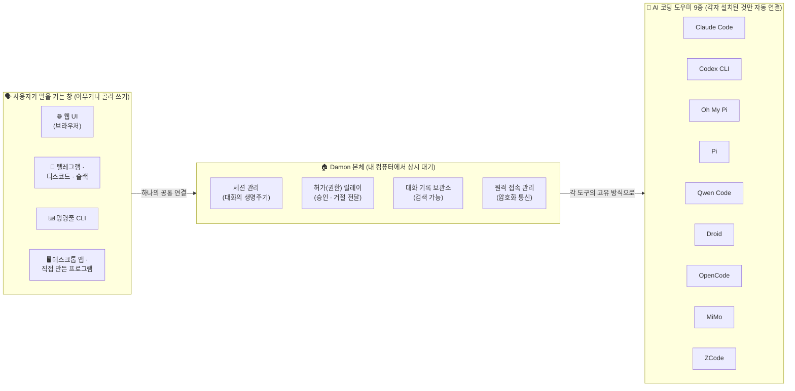
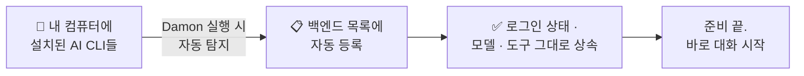
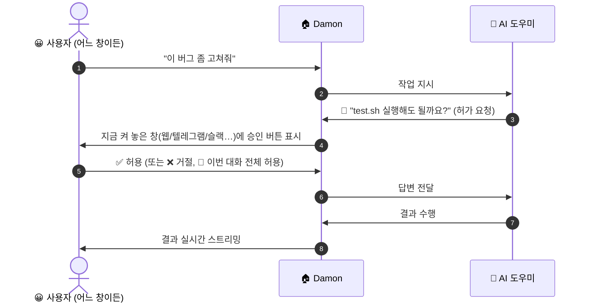
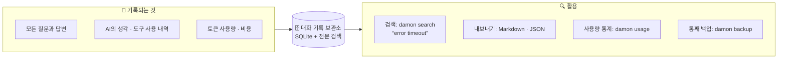
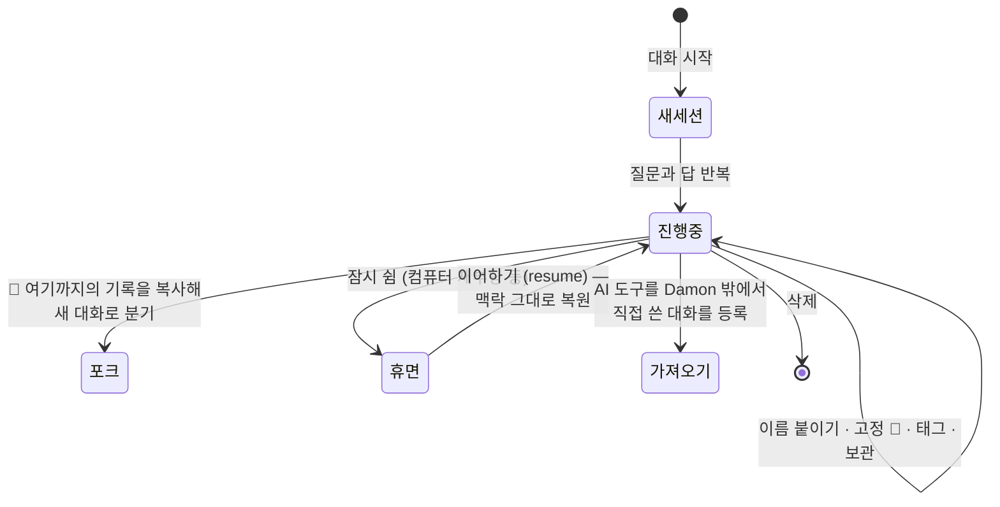
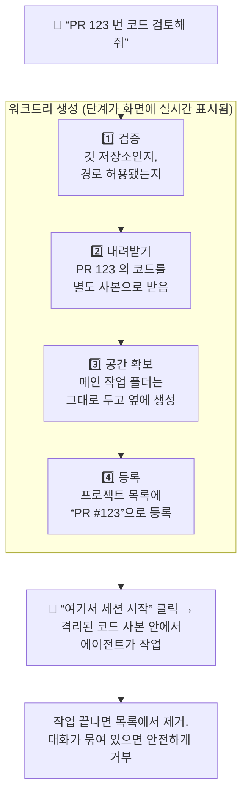
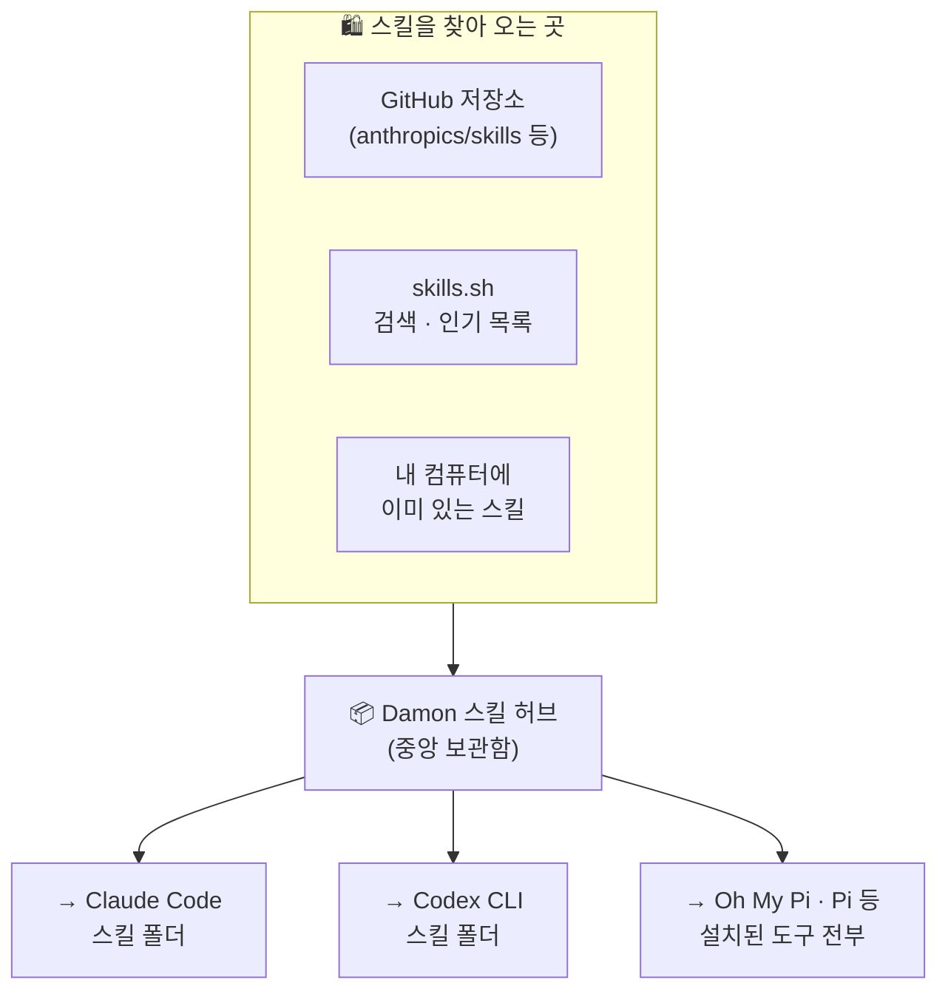
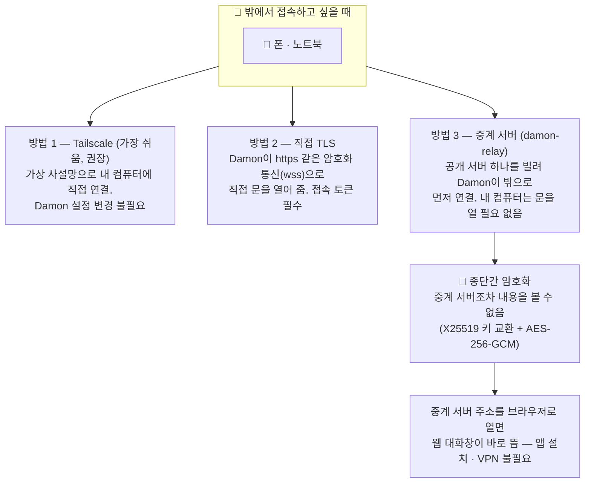
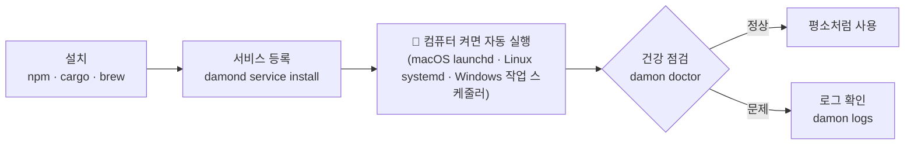
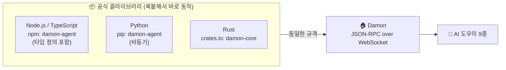

# Damon 기능 안내서 — 한눈에 보기

> 이 문서는 **비개발자도 읽을 수 있도록** 쉬운 말로 작성했습니다.
> Damon이 무엇이고, 어떤 기능을 제공하는지 그림과 함께 설명합니다.
> 같은 내용을 브라우저에서 바로 볼 수 있는 그림 버전은
> [features.ko.html](features.ko.html)입니다.

---

## Damon이 무엇인가요?

Damon은 **AI 코딩 도우미(에이전트)들을 한 곳에서 관리해 주는 관제센터**입니다.

요즘 AI 코딩 도구는 여러 가지가 있습니다 — Claude Code, Codex, Qwen 코드 등.
각각 따로 설치하고 따로 켜야 하고, 회사 컴퓨터에서 돌린 대화를 밖에서 폰으로
이어 보기도 어렵습니다.

Damon은 이런 불편을 해소합니다:

- **AI 도구 9종을 한 번에 구동** — 이미 설치·로그인된 CLI를 자동으로 찾아 연결합니다. 추가 설정이 없습니다.
- **어디서나 같은 대화** — 웹 브라우저, 텔레그램, 디스코드, 슬랙, CLI 어디서나 접속해 같은 세션을 이어갑니다.
- **모든 대화가 기록되고 검색됩니다** — "그때 타임아웃 오류 얘기했던 대화"를 나중에 찾아볼 수 있습니다.

이름의 유래: 유닉스에서 늘 뒤에서 조용히 도는 프로그램을 *daemon(데몬)*이라고
부릅니다. Damon은 그 말장난이자 실제 모습 그대로, 컴퓨터에서 상시 대기하며
AI 도구들과 사용자를 이어주는 역할만 합니다.

---

## 전체 구조 한눈에 보기

사용자는 왼쪽의 아무 창이나 켜서 말을 걸고, Damon이 알아서 오른쪽의
AI 도구에게 전달합니다. AI 도구를 몇 개 설치했든 사용자에게는 똑같은
화면 하나입니다.

**역할 분담이 핵심입니다.** AI 모델 선택, 도구(툴), 로그인 인증, 대화 맥락
관리는 전부 각 AI 도구가 알아서 합니다. Damon은 사용자가 직접 겪는 부분 —
대화 창, 기록, 허가 승인, 원격 접속 — 만 책임집니다. 그래서 Damon 안에
API 키를 넣거나 계정을 연동할 일이 없습니다.

---

## 기능 1 — AI 코딩 도우미 9종, 설정 없이 통합 구동

AI 도구가 컴퓨터에 설치되어 있고 로그인까지 되어 있다면, Damon을 켜자마자
자동으로 찾아 등록합니다. Damon 쪽에 새로 입력하는 것은 없습니다.

| AI 도구 | 만든 곳 | 비고 |
| --- | --- | --- |
| Claude Code | Anthropic | |
| Codex CLI | OpenAI | |
| Oh My Pi (omp) | Oh My Pi | |
| Pi | Pi | omp와 같은 통신 방식 |
| Qwen Code | Alibaba | |
| Droid | Factory | |
| OpenCode | OpenCode | `opencode serve` 자동 연결 |
| MiMo | Xiaomi | OpenCode와 같은 방식 |
| ZCode | Z.ai | |

- `damond doctor` 명령으로 "내 컴퓨터에 어떤 AI 도구가 연결 가능한지" 확인할 수 있습니다.
- AI 도구가 예고 없이 꺼지면 Damon이 스스로 다시 켜기를 시도하고(1초 → 2초 → 4초… 점점 길게), 계속 실패하면 잠시 쉬었다가 재시도합니다. 사용자가 직접 관리할 필요가 없습니다.
- 카탈로그에 오르는 도구는 모두 "대화 중간에 허가를 물을 수 있는" 양방향 통신이 가능한 것만 등재되어, 어느 도구를 써도 같은 수준으로 제어됩니다.

---

## 기능 2 — 어디서나 대화: 접속 창 6가지

Damon 본체 하나에 여러 개의 "창"이 동시에 붙을 수 있습니다. 회사에서는
웹으로, 출퇴근 중에는 텔레그램으로, 같은 대화를 이어볼 수 있습니다.

| 접속 창 | 모습 | 특징 |
| --- | --- | --- |
| 🌐 웹 UI | 브라우저에서 `http://127.0.0.1:9470/ui` | 별도 설치 불필요. 답변이 실시간으로 흘러나오고 코드에 색이 입혀짐 |
| ⌨️ CLI | 터미널에서 `damon chat` | 명령줄 선호자용. 한 줄 질문(`damon prompt`)도 가능 |
| 💬 텔레그램 | `damon-telegram` 실행 | 폰에서 대화. 허가 요청이 버튼으로 도착 |
| 💬 디스코드 | `damon-discord` 실행 | 채널별로 다른 대화 세션 자동 매핑 |
| 💬 슬랙 | `damon-slack` 실행 | 버튼형 허가 승인 지원 (Socket Mode) |
| 🖥️ 직접 만든 앱 | Rust · Node.js · Python 라이브러리 | 데스크톱 앱이나 자동화 스크립트에 직접 연결 |

채팅 채널(텔레그램/디스코드/슬랙)에서는 채팅방마다 에이전트 세션이
자동으로 배정되고, 채팅창에 올린 **파일도 그대로 질문에 첨부**됩니다.

채팅에서 쓸 수 있는 특별 명령(`!`로 시작):

| 명령 | 하는 일 |
| --- | --- |
| `!new` `!fork` `!delete` `!cancel` | 새 대화 시작 / 대화 복제 / 삭제 / 진행 중 작업 중단 |
| `!cwd <폴더>` `!agent <도구>` | 이 채팅이 작업할 폴더와 AI 도구 지정 |
| `!usage` | 토큰 사용량 확인 |
| `!sessions` `!resume <이름>` | 다른 화면에서 시작한 대화 목록 보기 / 이 채팅에서 이어하기 |
| `!watch` `!unwatch` | 다른 화면에서 돌고 있는 대화를 지켜보고, 끝나거나 허가가 필요하면 이 채팅으로 알림 받기 |

---

## 기능 3 — 허가(권한) 승인: AI가 뭘 하기 전에 물어봅니다

AI 도우미는 파일을 고치거나 명령을 실행할 때 "해도 될까요?"라고 물어야 할
때가 있습니다. Damon은 이 질문을 **지금 접속해 있는 어떤 창으로든** 전달하고,
사용자의 답을 AI에게 그대로 전합니다.

- 답은 **허용 / 거절 / 이번 세션 전체 허용(always)** 세 가지입니다.
- 5분(기본값, 변경 가능) 동안 답이 없으면 자동으로 거절 처리됩니다 — 방치해도 안전합니다.
- 웹 UI와 CLI, 그리고 세 채팅 채널 모두 같은 방식으로 동작합니다. 텔레그램에서 시작한 작업이 웹에서 본 허가 요청에 답해도 됩니다.

---

## 기능 4 — 모든 대화를 기록하고, 나중에 검색

Damon을 거친 모든 대화는 내 컴퓨터의 기록 보관소(SQLite 데이터베이스)에
저장됩니다. 기록은 나중에 전문(full-text) 검색으로 찾을 수 있습니다.

- 검색은 단어 여러 개를 AND로 묶거나 `"정확한 문구"`, OR, NOT 같은 문법을 지원합니다.
- 오래된 대화는 보존 기간(기본 30일, 해제 가능)이 지나면 자동 정리됩니다.
- 기록 보관소는 프로그램이 돌고 있는 중에도 안전하게 복사되는 `damon backup` 명령이 있습니다.

---

## 기능 5 — 대화(세션) 관리

하나의 "대화 덩어리"를 세션이라고 부릅니다. Damon은 세션을 문서처럼
다룰 수 있게 해 줍니다.

- **이어하기(resume):** 컴퓨터를 재부팅하거나 Damon을 껐다 켜도 대화 맥락이 그대로 복원됩니다.
- **포크(fork):** "이 대화를 그대로 복사해서 다른 방향으로 키워 보고 싶을 때" 유용합니다. 원본은 그대로 남습니다.
- **가져오기(import):** 예전에 AI 도구를 Damon 없이 직접 써서 만든 대화도 찾아서 Damon으로 데려올 수 있습니다.
- **지켜보기(watch):** 웹에서 돌리고 있는 대화를 텔레그램에서 지켜보다가, 허가 요청이 오면 텔레그램에서 바로 승인할 수 있습니다.
- **끊김 없는 작업(detach):** 폰으로 작업을 시켜 두고 잠그거나 지하철로 옮겨도(Wi-Fi→셀룰러 전환 등) 작업은 계속 돌아갑니다. 다시 접속하면 결과를 확인할 수 있습니다.
- **중간 지시(steer):** AI가 일하는 도중에 "아 그리고 이것도 확인해 줘"를 덧붙일 수 있습니다.
- **모델 · 모드 전환:** 대화 중간에도 AI 모델이나 허가 모드(예: 읽기 전용 모드)를 바꿀 수 있습니다.

---

## 기능 6 — 프로젝트와 워크트리: PR 하나에 에이전트 하나

여러 작업을 동시에 벌일 때, 각각의 코드 사본을 깔끔하게 격리하고 싶을 때가
있습니다. Damon은 **"PR 하나, 에이전트 하나"** 방식의 격리 작업 공간을 제공합니다.

- GitHub의 PR 번호(`123`), `#123`, PR 링크 어느 것이든 이해하고, `gh` 도구가 있으면 PR 제목과 상태까지 미리 보여 줍니다.
- 내려받기 도중 취소할 수 있고, 실수로 같은 PR을 또 요청하면 이미 만든 공간을 그대로 재사용합니다.
- **프로젝트** 개념도 함께 제공합니다: 폴더별로 "기본 AI 도구 · 모델 · 모드"를 정해 두면, 그 프로젝트에서 새 대화를 시작할 때 자동으로 적용됩니다.

---

## 기능 7 — 스킬 허브: 능력 한 번 설치, 모든 도구에 배포

"스킬"은 AI 도우미에게 주는 추가 능력(예: PDF 다루기, 엑셀 작성법)입니다.
문제는 도구마다 스킬을 넣어 두는 폴더가 달라서, 9종에 각각 설치하려면
같은 일을 아홉 번 해야 한다는 것입니다.

Damon의 스킬 허브는 **한 번 설치하면 설치된 모든 AI 도구의 스킬 폴더로
자동 배포(동기화)**해 줍니다.

- 설치: `damon skills install anthropics/skills document-skills/pdf`
- 제거해도 5분 안에는 되돌릴 수 있습니다(휴지통 개념).
- 업데이트가 있는지 주기적으로 확인해 알려 줍니다.
- **프롬프트 라이브러리**: 자주 쓰는 지시문(프롬프트)을 저장해 두고, 대화 입력창에서 `!`를 눌러 꺼내 쓸 수 있습니다. 프로젝트 폴더용과 전역용을 지원합니다.

웹 UI의 대화 입력창에서 쓸 수 있는 보조 선택기 3종:

| 입력 | 뜻 | 동작 |
| --- | --- | --- |
| `/` | 명령 · 스킬 선택 | 설치된 AI 도구가 이미 알고 있는 명령과 스킬 목록 |
| `@` | 파일 선택 | 프로젝트 파일을 검색해 대화에 첨부 |
| `!` | 프롬프트 선택 | 저장해 둔 프롬프트를 꺼내 내용 채워 넣기 |

---

## 기능 8 — 집 밖에서도 접속: 원격 접근 3가지

Damon은 내 컴퓨터에서 돌기 때문에, 기본적으로는 같은 네트워크에서만
접속됩니다. 밖에서 접속하고 싶다면 아래 세 방법 중 하나를 씁니다.

- 세 방법 모두 최종적으로는 같은 Damon 본체에 도착하므로, 집 컴퓨터의
  대화를 폰에서 이어보게 됩니다.
- 보안 장치: 외부에 노출되는 연결에는 **접속 토큰이 필수**이고, 틀린 토큰은
  즉시 거부됩니다. 브라우저 로그인 형태(주소창에 토큰이 남지 않는 방식)로
  안전하게 처리됩니다.

---

## 기능 9 — 안전장치 일람

Damon은 "내 컴퓨터에서 AI가 파일을 만지는" 구조이므로, 안전장치가
여러 겹으로 들어 있습니다.

| 안전장치 | 하는 일 |
| --- | --- |
| 접속 토큰 | 외부 접속에는 반드시 토큰 필요. 없으면 애초에 실행 거부 |
| 폴더 허용 목록 (`allowed_dirs`) | 에이전트가 작업할 수 있는 폴더를 미리 제한 |
| 허가 질의 | AI가 위험한 작업을 하기 전 반드시 사용자 승인 (기능 3) |
| 허가 시간 제한 | 답이 없는 허가 요청은 5분 후 자동 거절 |
| 요청 횟수 제한 | 외부 접속에는 분당 요청 수 제한(과도한 호출 차단) |
| 비밀번호 보관 | Damon 설정에는 비밀 키를 직접 쓰지 않고 `env:`(환경변수), `keychain:`(macOS 열쇠고리) 등 참조만 허용 |
| 파일 접근 제한 | 원격에서 파일을 읽고 쓰는 기능은 그 세션의 작업 폴더로만 한정 |
| 암호화 통신 | 원격 연결은 종단간 암호화(중계 서버도 내용 불가시) |

---

## 기능 10 — 늘 켜 두기: 상시 운영

Damon은 한 번 켜 두고 잊고 사는 것이 기본 사용법입니다.

- **설치 방법 3가지**: `npm install -g damon-agent` / `cargo install damon-core` / `brew install developjik/tap/damon`
- **설정 변경은 즉시 반영**(재시작 없이 대부분 항목이 자동 갱신)됩니다. 설정 파일은 주석 달린 예시 한 장(`config.example.toml`)이 전부이고, 아무것도 없어도 동작합니다.
- **자동 정리**: 유휴 에이전트는 30분 후 조용히 정리(대화는 유지), 오래된 세션은 보존 기간에 따라 정리, 동시 세션 수 상한도 설정 가능합니다.
- **관측**: `damon logs`(실시간 로그 보기), `damon doctor`(연결 상태 점검), `/metrics`(프로메테우스 지표), `/health`(생존 확인).

---

## 기능 11 — 개발자를 위한 문 (API · 라이브러리)

> 이 절은 프로그램을 직접 만드는 분들에 해당합니다. 비개발자는 넘어가도 됩니다.

Damon의 모든 기능은 **하나의 통신 규격(JSON-RPC over WebSocket)**으로
노출됩니다. 공식 클라이언트가 세 언어로 제공되므로, Damon을 자기 앱에
"AI 백엔드"로 넣을 수 있습니다.

- 연결이 끊겼다 다시 연결되면 라이브러리가 알아서 재구독하고, 놓친 대화
  내용을 되감아 채워 줍니다.
- 데스크톱 앱 예시 코드와 통신 규격 전문은
  [docs/protocol-v2.ko.md](protocol-v2.ko.md) ·
  [docs/integration.ko.md](integration.ko.md)를 참고하세요.

---

## 한눈에 보는 기능 총정리

| 분류 | 기능 | 어디서 쓰나 |
| --- | --- | --- |
| 통합 구동 | AI 도구 9종 자동 탐지 · 구동 · 자동 재시작 | 자동 |
| 대화 | 실시간 스트리밍 답변, 코드 색상, 진행 중 취소/덧붙이기 | 모든 창 |
| 허가 | 허용/거절/전체허용, 시간 초과 자동 거절, 어떤 창에서든 승인 | 모든 창 |
| 기록 | 전체 대화 저장, 전문 검색, 내보내기(MD/JSON), 백업, 사용량 통계 | CLI · 웹 |
| 세션 | 이어하기, 포크, 이름·고정·태그·보관, 외부 세션 가져오기, 감시, 끊김 무관 작업 | 모든 창 |
| 프로젝트 | 폴더별 기본 설정, 워크트리 격리 작업 공간(PR 단위), 실시간 진행 표시 | CLI · 웹 |
| 스킬 | 중앙 설치 → 전 도구 동기화, GitHub/skills.sh 탐색, 휴지통 복원, 프롬프트 라이브러리 | CLI · 웹 |
| 입력 보조 | `/` 명령 · `@` 파일 · `!` 프롬프트 선택기, 입력 기록 자동완성 | 웹 |
| 원격 | Tailscale · TLS · 중계 서버(종단간 암호화), 브라우저만 있으면 접속 | 설정 선택 |
| 보안 | 접속 토큰, 폴더 허용 목록, 요청 제한, 키체인 비밀 참조, 파일 접근 한정 | 설정 |
| 운영 | 부팅 시 자동 실행, 상태 점검, 로그, 지표, 자동 정리, 설정 핫 리로드 | CLI |
| 개발자 | 통신 규격 공개, Rust·Node·Python 라이브러리 | 라이브러리 |

---

## 함께 보기

- [README.ko.md](../README.ko.md) — 빠른 시작
- [docs/install.ko.md](install.ko.md) — 설치 경로와 서비스 등록
- [docs/protocol-v2.ko.md](protocol-v2.ko.md) — 통신 규격 전문 (개발자용)
- [docs/integration.ko.md](integration.ko.md) — 직접 만든 앱 연결 (개발자용)
- [config.example.toml](../config.example.toml) — 모든 설정 항목 (주석 포함)
