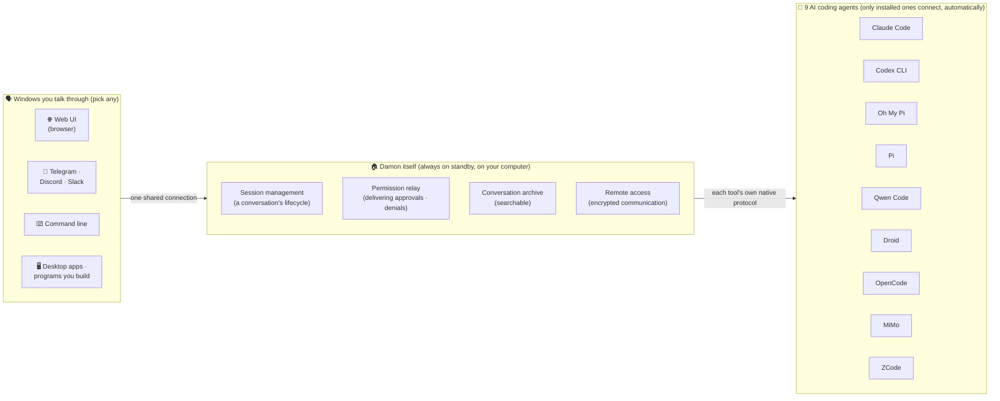
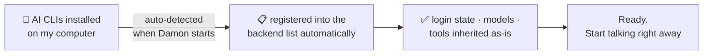
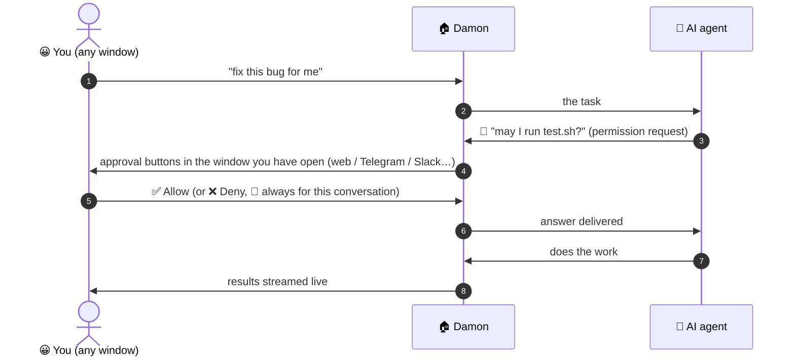
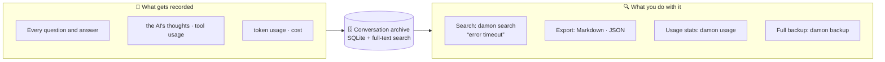
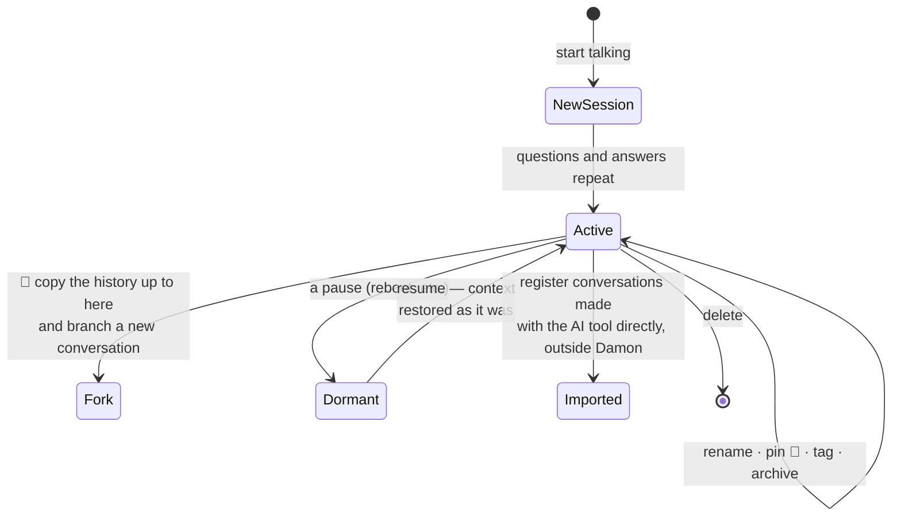
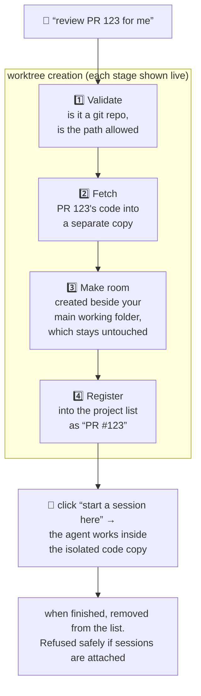
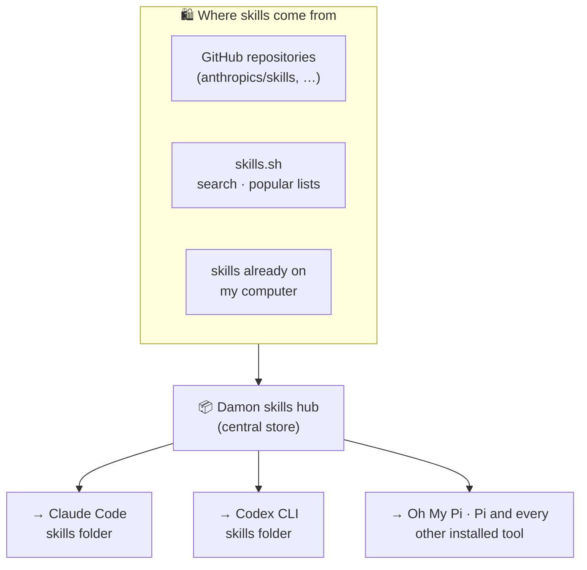
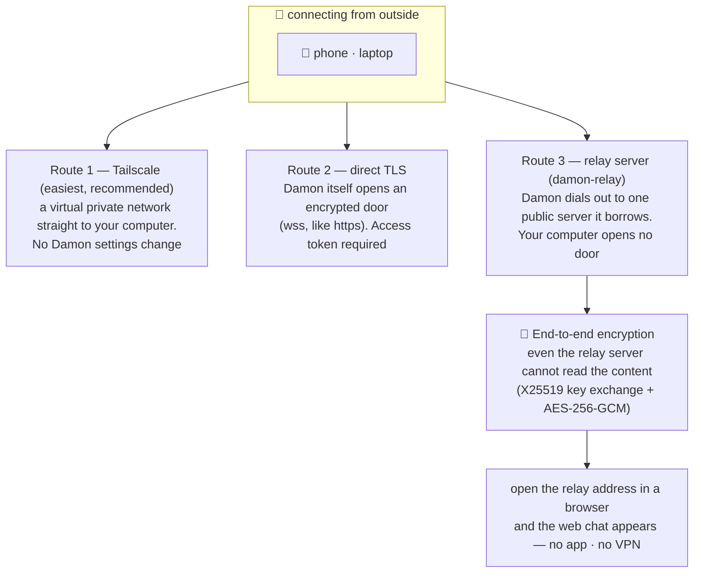
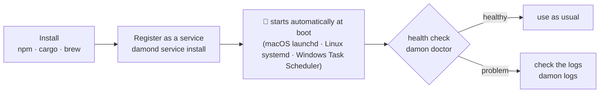
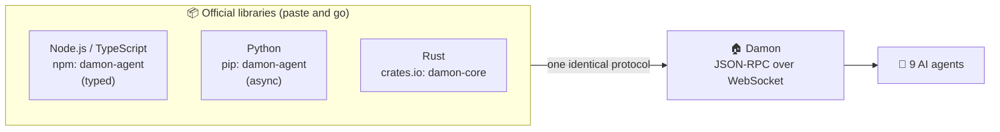

# The Damon Feature Guide — at a glance

> This guide is written in **plain language for non-developers**.
> It explains what Damon is and what it does, with pictures.
> A graphical, in-browser version of this guide (in Korean) is available at
> [features.ko.html](features.ko.html).

---

## What is Damon?

Damon is a **control center that manages your AI coding agents in one place**.

There are many AI coding tools these days — Claude Code, Codex, Qwen Code, and
more. Each one wants its own install, its own window, and the conversation you
ran on your work computer is hard to pick up later from your phone.

Damon removes that friction:

- **Runs 9 AI tools at once** — it finds and connects CLIs that are already
  installed and logged in. There is nothing extra to set up.
- **The same conversation everywhere** — web browser, Telegram, Discord,
  Slack, or the terminal; connect from any of them and pick up the same
  session.
- **Every conversation is recorded and searchable** — "that chat where we
  debugged the timeout error" is findable later.

Where the name comes from: Unix calls a program that quietly runs in the
background a *daemon*. Damon is that pun, and a literal description — it sits
on your computer, always on standby, connecting your AI tools to you and
nothing more.

---

## The whole structure at a glance

You open any of the windows on the left and start talking; Damon relays to
the AI tools on the right. However many AI tools you have installed, you see
one single, identical screen.

**The division of labor is the key.** Model choice, tools, login credentials,
and conversation context all belong to each AI tool. Damon owns only what you
actually touch — the chat window, the archive, permission approvals, and
remote access. That is why you never put API keys into Damon or link any
accounts to it.

---

## Feature 1 — 9 AI coding agents, driven together with zero setup

If an AI tool is installed on your computer and logged in, Damon finds and
registers it the moment it starts. There is nothing to type into Damon.

| AI tool | Maker | Note |
| --- | --- | --- |
| Claude Code | Anthropic | |
| Codex CLI | OpenAI | |
| Oh My Pi (omp) | Oh My Pi | |
| Pi | Pi | same transport as omp |
| Qwen Code | Alibaba | |
| Droid | Factory | |
| OpenCode | OpenCode | auto-connects to `opencode serve` |
| MiMo | Xiaomi | same transport as OpenCode |
| ZCode | Z.ai | |

- `damond doctor` shows "which AI tools on this computer are connectable".
- If an AI tool dies without warning, Damon tries to bring it back itself
  (1s → 2s → 4s … backing off), and after repeated failures rests briefly
  before retrying. You never manage this by hand.
- Only tools that support **two-way communication** — being able to ask for
  permission mid-conversation — are admitted to the catalog, so every tool is
  controllable to the same standard.

---

## Feature 2 — one conversation, six ways in

Many "windows" can attach to the one Damon at the same time. At the office
you use the web, on the commute you use Telegram, and it is the same
conversation continuing.

| Surface | What it looks like | Notes |
| --- | --- | --- |
| 🌐 Web UI | `http://127.0.0.1:9470/ui` in a browser | No install. Answers stream in live, code gets syntax color |
| ⌨️ CLI | `damon chat` in a terminal | For terminal people. One-shot questions (`damon prompt`) too |
| 💬 Telegram | run `damon-telegram` | Chat from your phone. Permission requests arrive as buttons |
| 💬 Discord | run `damon-discord` | Each channel maps to its own session automatically |
| 💬 Slack | run `damon-slack` | Button-style permission approvals (Socket Mode) |
| 🖥️ Your own app | Rust · Node.js · Python libraries | Connect desktop apps or automation scripts directly |

On the chat channels (Telegram/Discord/Slack), every chat room gets its own
agent session automatically, and **files dropped into the chat are attached**
to your question.

Special commands in chat (starting with `!`):

| Command | What it does |
| --- | --- |
| `!new` `!fork` `!delete` `!cancel` | start fresh / duplicate a conversation / delete / stop work in progress |
| `!cwd <folder>` `!agent <tool>` | choose the folder this chat works in and the AI tool it uses |
| `!usage` | check token usage |
| `!sessions` `!resume <name>` | list conversations started on other screens / continue one here |
| `!watch` `!unwatch` | watch a conversation running on another screen; get pinged here when it finishes or needs permission |

---

## Feature 3 — permission approvals: the AI asks before it acts

AI agents sometimes need to ask "may I?" before editing a file or running a
command. Damon delivers that question to **whichever window you are currently
using**, and hands your answer back to the AI verbatim.

- Answers are **allow / deny / allow-always-for-this-session**.
- No answer for 5 minutes (default, configurable) means an automatic denial —
  leaving it unattended is safe.
- The web UI, the CLI, and all three chat channels behave identically. You
  can answer a permission request on the web for work you started in
  Telegram.

---

## Feature 4 — every conversation recorded, and searchable later

Every conversation that passes through Damon lands in an archive on your own
computer (a SQLite database). Past chats are findable later with full-text
search.

- Search supports multi-word AND, `"exact phrases"`, OR, and NOT syntax.
- Old conversations are cleaned up automatically once past the retention
  period (default 30 days, removable).
- The archive can be safely copied while the program is running, via
  `damon backup`.

---

## Feature 5 — conversation (session) management

One "conversation bundle" is called a session. Damon lets you treat sessions
like documents.

- **Resume:** after a reboot or a Damon restart, the conversation context
  comes back intact.
- **Fork:** for "copy this conversation and grow it in a different
  direction". The original stays untouched.
- **Import:** conversations you created earlier with an AI tool directly,
  without Damon, can be found and brought into Damon.
- **Watch:** follow a conversation running on the web from Telegram, and
  approve its permission requests right there in Telegram.
- **Detach:** set work running from your phone, lock the phone or hop onto
  the subway (Wi-Fi → cellular, etc.) — the work keeps running, and you check
  the results when you reconnect.
- **Steer:** while the AI is working you can tack on "oh, and check this
  too".
- **Model · mode switching:** mid-conversation, you can switch the AI model
  or the permission mode (e.g. read-only).

---

## Feature 6 — projects & worktrees: one PR, one agent

When running several tasks in parallel, you sometimes want each one in a
cleanly isolated copy of the code. Damon provides isolated workspaces in a
**"one PR, one agent"** style.

- It understands a GitHub PR number (`123`), `#123`, or a full PR link alike,
  and if the `gh` tool is present it previews the PR title and status.
- You can cancel mid-download, and requesting the same PR twice reuses the
  workspace that already exists.
- There is a **project** concept too: set "default AI tool · model · mode"
  per folder and every new conversation in that project picks it up
  automatically.

---

## Feature 7 — skills hub: install a capability once, deploy it to every tool

A "skill" is an extra ability you give your AI agent (handling PDFs, writing
spreadsheets, …). The trouble is each tool keeps skills in a different
folder, so installing one for nine tools means doing the same job nine times.

Damon's skills hub **installs once and automatically deploys (syncs) to the
skill folders of every installed AI tool**.

- Install: `damon skills install anthropics/skills document-skills/pdf`
- Removal is undoable for 5 minutes (a trash-bin concept).
- Damon periodically checks for updates and tells you.
- **Prompt library**: save the instructions (prompts) you use often and pull
  them up in the composer by typing `!`. Per-project and global scopes are
  supported.

Three helper pickers in the web UI composer:

| You type | Means | What happens |
| --- | --- | --- |
| `/` | command · skill picker | commands and skills your installed AI tools already know |
| `@` | file picker | search project files and attach them to the conversation |
| `!` | prompt picker | pull a saved prompt and fill in its content |

---

## Feature 8 — reach it from outside your home: three remote-access routes

Damon runs on your computer, so by default it is reachable from the same
network. To connect from outside, use one of these three.

- All three routes end at the same Damon, so you pick up your home
  computer's conversations on your phone.
- Safety rails: connections exposed outside **require an access token**, and
  a wrong token is rejected instantly. It is handled as a browser login form
  (so the token never stays in the address bar).

---

## Feature 9 — the safety checklist

Damon's structure is "AI touching files on my computer", so it layers several
safeguards.

| Safeguard | What it does |
| --- | --- |
| Access token | outside access always requires a token; without one, Damon refuses to expose itself at all |
| Folder allowlist (`allowed_dirs`) | pre-limits which folders agents may work in |
| Permission asks | the AI must get user approval before risky actions (Feature 3) |
| Permission timeout | unanswered permission requests auto-deny after 5 minutes |
| Rate limiting | outside connections get a per-minute request cap (blocks excessive calls) |
| Secret storage | Damon config never stores raw secrets — only references like `env:` (environment variables), `keychain:` (macOS keychain) |
| File access jail | remote file read/write is confined to the session's working folder |
| Encrypted transport | remote connections are end-to-end encrypted (invisible even to the relay server) |

---

## Feature 10 — always on: running it resident

Damon's intended usage is to start it once and forget about it.

- **Three install paths**: `npm install -g damon-agent` / `cargo install damon-core` / `brew install developjik/tap/damon`
- **Config changes apply immediately** (most items hot-reload without a
  restart). The configuration surface is one commented example file
  (`config.example.toml`) — it also runs with nothing.
- **Auto-cleanup**: idle agents are quietly reaped after 30 minutes
  (conversations preserved), old sessions expire per the retention policy,
  and concurrent session counts are capped.
- **Observability**: `damon logs` (live log view), `damon doctor`
  (connectivity check), `/metrics` (Prometheus metrics), `/health`
  (liveness).

---

## Feature 11 — the developers' door (API · libraries)

> This section is for people who build their own software.
> Non-developers can skip it.

Every Damon capability is exposed through **one protocol (JSON-RPC over
WebSocket)**. Official clients ship in three languages, so you can drop Damon
into your own app as its "AI backend".

- If the connection drops and comes back, the library resubscribes on its own
  and rewinds to fill in whatever you missed.
- For desktop app examples and the full protocol spec, see
  [docs/protocol-v2.md](protocol-v2.md) and
  [docs/integration.md](integration.md).

---

## Everything at a glance

| Area | Capability | Where you use it |
| --- | --- | --- |
| Unified runtime | 9 AI tools auto-detected · driven · auto-restarted | automatic |
| Conversation | live streaming answers, syntax color, cancel/steer mid-turn | every window |
| Permissions | allow/deny/always, timeout auto-deny, approve from any window | every window |
| Archive | full conversation storage, full-text search, export (MD/JSON), backup, usage stats | CLI · web |
| Sessions | resume, fork, rename·pin·tag·archive, external session import, watch, detach-friendly work | every window |
| Projects | per-folder defaults, worktree isolation per PR, live progress | CLI · web |
| Skills | central install → sync to every tool, GitHub/skills.sh discovery, trash restore, prompt library | CLI · web |
| Composer helpers | `/` command · `@` file · `!` prompt pickers, input history autocomplete | web |
| Remote | Tailscale · TLS · relay server (end-to-end encrypted), browser-only access | opt-in via settings |
| Security | access token, folder allowlist, rate limits, keychain secret references, file access jail | settings |
| Operations | auto-start at boot, health checks, logs, metrics, auto-cleanup, config hot-reload | CLI |
| Developers | public protocol, Rust · Node · Python libraries | libraries |

---

## See also

- [README.md](../README.md) — quick start
- [docs/install.md](install.md) — install paths and service registration
- [docs/protocol-v2.md](protocol-v2.md) — full protocol spec (for developers)
- [docs/integration.md](integration.md) — connecting your own app (for developers)
- [config.example.toml](../config.example.toml) — every setting, commented
